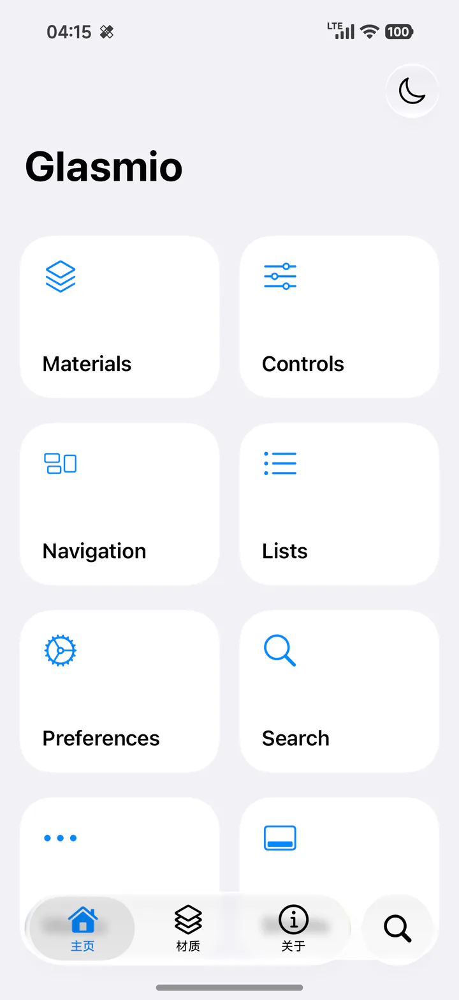

# Glasmio

An Android-first Jetpack Compose UI framework with Liquid Glass materials, continuous corners, and iOS-style controls. Glasmio owns presentation and interaction. Your application owns data, navigation, preferences, and font resources.



All six libraries share version `0.1.0` and the Maven group `io.github.neoruaa.glasmio`.

## Modules

| Artifact | Provides |
| --- | --- |
| `glasmio-core` | Light/dark themes, colors, typography, continuous shapes, spacing, motion |
| `glasmio-glass` | Backdrop recording, blur, refraction, highlights, shadows, liquid menu morphs |
| `glasmio-ui` | Buttons, switches, sliders, fields, lists, menus, alerts, sheets, toolbars, navigation |
| `glasmio-scaffold` | Insets, collapsing titles, lazy pages, overscroll, refresh, sheet state |
| `glasmio-preference` | Preference rows, switches, choices, and validated text editing |
| `glasmio-icons` | Semantic symbol names, host-provided SF font rendering, replaceable icon resolver |
| `sample` | Interactive component catalog with light/dark, RTL, and reduced-transparency modes |

UI dependencies expose their underlying modules transitively. Add the highest-level modules you use.

## Build and run

Requires JDK 21, Android SDK 37, NDK `27.1.12297006`, and CMake `3.22.1`. The minimum supported Android version is API 33. The repository includes its Gradle wrapper.

```sh
./gradlew :sample:assembleDebug testDebugUnitTest lintDebug
adb install -r sample/build/outputs/apk/debug/sample-debug.apk
```

Run the component behavior tests on an Android device or emulator:

```sh
./gradlew :sample:connectedDebugAndroidTest
```

The sample demonstrates materials, controls, navigation, lists, preferences, search, menus, and sheets. Its Home, Materials, Settings, and About tabs share a navigation bar with a separate search button. Pages use collapsing titles and progressive edge blur. Root tabs fade between destinations; detail pages use Miuix transitions. It builds independently of MeiloX.

To render the catalog with SF Symbols, supply your local symbol font for debug builds:

```sh
./gradlew :sample:assembleDebug "-Pglasmio.symbolFont=/absolute/path/SF Pro.ttf"
```

You can also set `glasmio.symbolFont` in the ignored root `local.properties`. The debug build generates a local font asset and installs one icon provider around the entire catalog. With the SF Pro variable font, the sample also selects text weight and optical size from that asset. Release artifacts and published libraries do not contain that font.

## Use in an application

Enable Google Maven and Maven Central in your application's settings:

```kotlin
dependencyResolutionManagement {
    repositories { google(); mavenCentral() }
}
```

Then declare the modules you need:

```kotlin
dependencies {
    implementation("io.github.neoruaa.glasmio:glasmio-scaffold:0.1.0")
    implementation("io.github.neoruaa.glasmio:glasmio-preference:0.1.0")
}
```

Install the theme and an explicit backdrop host. Keep the sampled background separate from glass controls:

```kotlin
import androidx.compose.foundation.background
import androidx.compose.foundation.layout.*
import androidx.compose.material3.Text
import androidx.compose.runtime.*
import androidx.compose.ui.Modifier
import androidx.compose.ui.unit.dp
import io.github.neoruaa.glasmio.core.*
import io.github.neoruaa.glasmio.glass.*
import io.github.neoruaa.glasmio.ui.*

@Composable
fun GreetingScreen() {
    GlasmioTheme {
        val colors = GlasmioTheme.colors
        GlasmioBackdropHost(
            modifier = Modifier.fillMaxSize(),
            sampledContent = {
                Box(Modifier.fillMaxSize().background(colors.groupedBackground))
            },
            overlayContent = {
                var enabled by remember { mutableStateOf(true) }
                Column(Modifier.safeDrawingPadding().padding(24.dp)) {
                    Text("Hello, Glasmio", style = GlasmioTheme.typography.headlineLarge)
                    Spacer(Modifier.height(24.dp))
                    GlasmioSwitch(checked = enabled, onCheckedChange = { enabled = it })
                }
            },
        )
    }
}
```

Every rounded theme surface uses `ContinuousRoundedRectangle`. Capsules retain their continuous outline. Customize `GlasmioShapes`, `GlassDimensions`, or the supplied typography without replacing the component system.

## SF Symbols throughout the application

Provide your licensed symbol font once at the application root. Every `SfIcon`, including icons inside Glasmio controls, then uses that source. Font files remain owned by the host application.

```kotlin
val context = LocalContext.current
val symbolTypeface = remember(context.applicationContext) {
    ResourcesCompat.getFont(context.applicationContext, R.font.sf_pro)
}
GlasmioIconProvider(symbolTypeface = symbolTypeface) {
    GreetingScreen()
}
```

The example uses `androidx.compose.ui.platform.LocalContext`, `androidx.core.content.res.ResourcesCompat`, and your application's `R`. Glasmio does not redistribute Apple fonts. Without a supplied font, semantic Material icons provide a visible fallback. A custom `GlasmioIconResolver` can supply your own vectors.

## Documentation

- [Component catalog and examples](docs/components.md)
- [Backdrop hosting and modal sampling](docs/backdrop.md)
- [Migration from MeiloX](MIGRATION.md)
- [Module and dependency boundaries](docs/migration-dependencies.md)
- [Publishing](docs/releasing.md)
- [Changelog](CHANGELOG.md)

## License

[Apache-2.0](LICENSE). Third-party dependencies and host-provided resources retain their own licenses; see [third-party notices](THIRD_PARTY_NOTICES.md).
