# Glasmio

[English](README.md) | **简体中文**

Glasmio 是一个 Jetpack Compose UI 框架，致力于在 Android 上 1:1 忠实复刻 iOS 27 的 Liquid Glass、动画、控件和交互。

Glasmio 是基于 iOS 界面与交互研究开发的独立第三方实现，复刻了玻璃渲染与光学折射、动画与导航转场、手势及组件行为。Glasmio 负责界面呈现和交互，应用负责数据、导航、偏好设置和字体资源。

## 研究与复刻

Glasmio 结合 iOS 运行时分析、UIKit 与 SwiftUI 检查、设计参考和实机采集，在 Android 上重现 iOS 27 的视觉与交互行为。

- **Liquid Glass：** Android 渲染管线将逆向得到的材质方程和实测参数用于背景采样、模糊、光学折射、高光、阴影、着色及 HDR 效果。控件透镜和液态菜单形变使用各自的材质行为。详见[原生材质渲染](docs/native-materials.md)。
- **动画与交互：** 导航转场、折叠标题、手势、菜单和 Sheet 的动画与交互模型参考了原生分析及采集结果，包括弹簧响应和手势释放行为。详见[导航](docs/ios-navigation-motion.md)、[Sheet](docs/ios-sheet-motion.md)和[菜单](docs/dropdown-motion.md)参考文档。
- **组件：** 控件、列表、字体排版、文本选择等组件将研究所得的几何形态和行为带入 Jetpack Compose。详见[设计参考](docs/design-reference.md)和[组件目录](docs/components.md)。

Glasmio 为 Android 独立实现这些效果和交互，不执行 Apple 的 Metal 二进制文件。宿主应用可以提供自己的字体和符号资源。

## 效果展示

| 组件目录 | 材质 · 浅色 | 材质 · 深色 |
| --- | --- | --- |
| 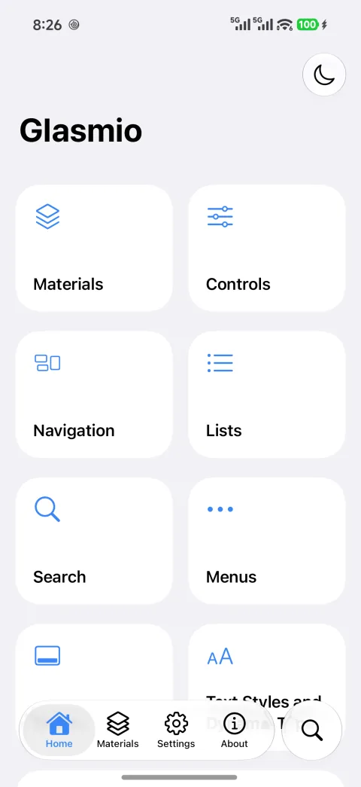 | 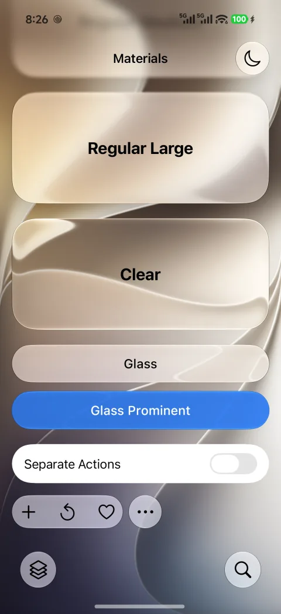 | 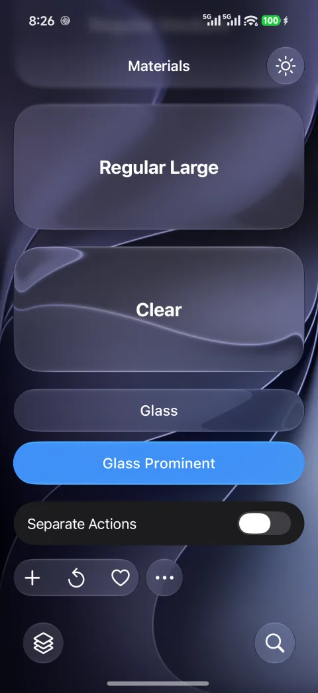 |

| 控件 | 列表 | Sheet |
| --- | --- | --- |
| 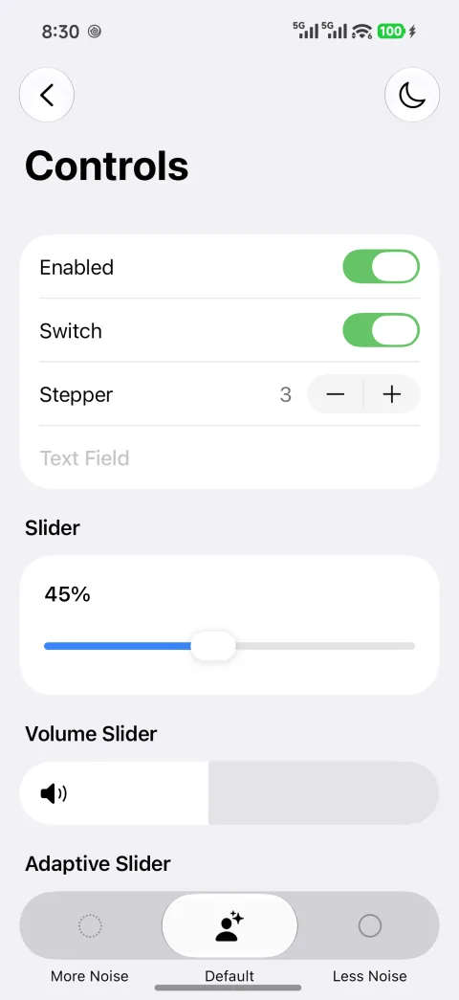 | 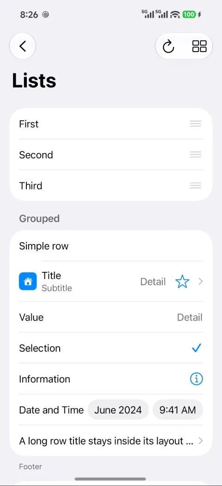 | 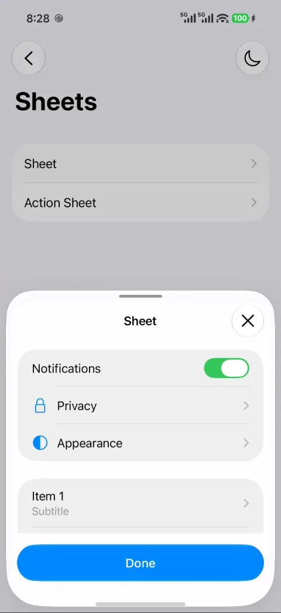 |

| 首页与列表转场 | 导航拖动 | 导航栏收展 · 快速与缓慢滑动 |
| --- | --- | --- |
| 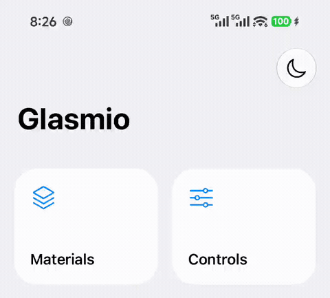 | 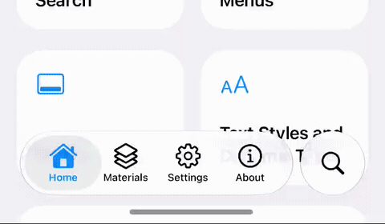 | 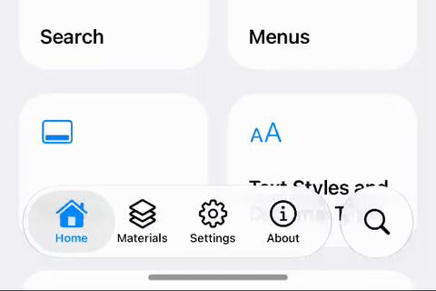 |

| Sheet 手势 | 文本选择工具栏 | 液态菜单 |
| --- | --- | --- |
| 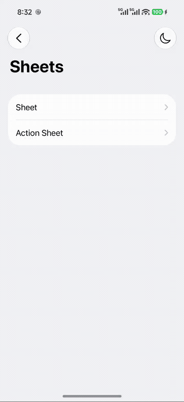 | 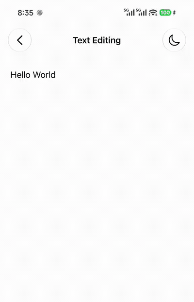 | 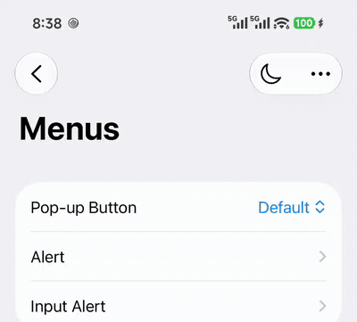 |

六个库使用统一版本 `0.1.0`，Maven 组名为 `io.github.neoruaa.glasmio`。

## Demo 应用

[下载 Demo APK](https://github.com/NEORUAA/Glasmio/releases/download/demo-2026-10-31/Glasmio-demo.apk)

需要 Android 13（API 33）或更高版本。Demo 包含 SF Pro、SF Symbols 和真正的斜体字体；库产物不含字体文件。

## 模块

| 产物 | 功能 |
| --- | --- |
| `glasmio-core` | 浅色与深色主题、颜色、字体排版、连续曲线形状、间距、动效 |
| `glasmio-glass` | 背景录制、模糊、折射、高光、阴影、液态菜单形变 |
| `glasmio-ui` | 按钮、开关、滑块、输入框、列表、菜单、弹窗、Sheet、工具栏、导航 |
| `glasmio-scaffold` | 窗口边距、折叠标题、惰性加载页面、过度滚动、刷新、Sheet 状态 |
| `glasmio-preference` | 偏好设置行、开关、选项和带验证的文本编辑 |
| `glasmio-icons` | 语义化符号名称、宿主提供的 SF 字体渲染、可替换的图标解析器 |
| `sample` | 支持浅色、深色、RTL 和降低透明度模式的交互式组件目录 |

UI 模块会传递暴露其底层依赖，添加所需的最高层模块即可。

`glasmio-glass` 在 `io.github.neoruaa.glasmio.glass.render` 命名空间下负责背景录制和材质渲染，无需单独依赖 Kyant Backdrop。直接使用相关 API 的应用需要将导入迁移至该命名空间。连续形状依赖及原有第三方归属声明保持不变。

## 构建与运行

需要 JDK 21、Android SDK 37、NDK `27.1.12297006` 和 CMake `3.22.1`。最低支持 Android API 33。仓库包含 Gradle Wrapper。

```sh
./gradlew :sample:assembleDebug testDebugUnitTest lintDebug
adb install -r sample/build/outputs/apk/debug/sample-debug.apk
```

在 Android 设备或模拟器上运行组件行为测试：

```sh
./gradlew :sample:connectedDebugAndroidTest
```

示例应用展示材质、控件、导航、列表、偏好设置、文本样式、搜索、菜单和 Sheet。Home、Materials、Settings 和 About 标签共用导航栏，并配有独立的悬浮搜索按钮。每个页面各自管理折叠标题和渐进式边缘模糊，页面之间只共享顶部工具栏按钮。根标签之间使用淡入淡出，详情页使用 Glasmio 的 iOS 风格转场和侧滑返回交互。示例应用可独立于 MeiloX 构建。

Settings 中的持久化选项会影响 Demo，其中 HDR Effects 和 FPS Counter 默认关闭。帧率计数器显示窗口渲染帧率和近期 1% Low，不会额外请求动画帧。偏好设置组件示例位于 Controls 的 Preference Rows 中。

使用 SF Pro 和其真正的斜体字体构建 Demo：

```sh
./gradlew :sample:assembleDemo \
  "-Pglasmio.symbolFont=/absolute/path/SF Pro.ttf" \
  "-Pglasmio.italicFont=/absolute/path/SF-Pro-Italic.ttf"
adb install -r sample/build/outputs/apk/demo/sample-demo.apk
```

Demo 构建必须同时提供这两个字体属性，缺少任一属性都会导致打包失败。Demo 启用 release 优化并使用 debug 签名密钥，与 sample 使用相同的应用 ID。

也可以在已被 Git 忽略的根目录 `local.properties` 中设置 `glasmio.symbolFont` 和 `glasmio.italicFont`。Debug 构建接受同样的可选属性，未设置时使用系统字体和备用图标。生成的示例资源为整个组件目录安装一个图标提供器；使用 SF Pro 可变字体时，示例还会从该资源选择字重和光学尺寸。这些示例字体不包含在库产物中。

## 在应用中使用

在应用设置中启用 Google Maven 和 Maven Central：

```kotlin
dependencyResolutionManagement {
    repositories { google(); mavenCentral() }
}
```

然后声明所需模块：

```kotlin
dependencies {
    implementation("io.github.neoruaa.glasmio:glasmio-scaffold:0.1.0")
    implementation("io.github.neoruaa.glasmio:glasmio-preference:0.1.0")
}
```

安装主题并显式设置背景宿主，将采样背景与玻璃控件分开：

```kotlin
import androidx.compose.foundation.background
import androidx.compose.foundation.layout.*
import androidx.compose.material3.Text
import androidx.compose.runtime.*
import androidx.compose.ui.Modifier
import androidx.compose.ui.unit.dp
import io.github.neoruaa.glasmio.core.*
import io.github.neoruaa.glasmio.glass.*
import io.github.neoruaa.glasmio.ui.*

@Composable
fun GreetingScreen() {
    GlasmioTheme {
        val colors = GlasmioTheme.colors
        GlasmioBackdropHost(
            modifier = Modifier.fillMaxSize(),
            sampledContent = {
                Box(Modifier.fillMaxSize().background(colors.groupedBackground))
            },
            overlayContent = {
                var enabled by remember { mutableStateOf(true) }
                Column(Modifier.safeDrawingPadding().padding(24.dp)) {
                    Text("Hello, Glasmio", style = GlasmioTheme.typography.headlineLarge)
                    Spacer(Modifier.height(24.dp))
                    GlasmioSwitch(checked = enabled, onCheckedChange = { enabled = it })
                }
            },
        )
    }
}
```

所有圆角主题表面均使用 `ContinuousRoundedRectangle`，胶囊形状也保留连续曲线轮廓。可以自定义 `GlasmioShapes`、`GlassDimensions` 或提供的字体排版，无需替换组件系统。

## 在应用中使用 SF Symbols

在应用根节点提供一次有许可的符号字体，所有 `SfIcon`（包括 Glasmio 控件内部的图标）都会使用该字体。字体文件由宿主应用持有。

```kotlin
val context = LocalContext.current
val symbolTypeface = remember(context.applicationContext) {
    ResourcesCompat.getFont(context.applicationContext, R.font.sf_pro)
}
GlasmioIconProvider(symbolTypeface = symbolTypeface) {
    GreetingScreen()
}
```

示例使用 `androidx.compose.ui.platform.LocalContext`、`androidx.core.content.res.ResourcesCompat` 和应用自身的 `R`。库产物不包含 Apple 字体文件。未提供字体时，语义化 Material 图标会作为可见的备用方案；也可以通过自定义 `GlasmioIconResolver` 提供自己的矢量图标。

## 文档

- [组件目录与示例](docs/components.md)
- [背景宿主与模态采样](docs/backdrop.md)
- [原生材质渲染与自动外观](docs/native-materials.md)
- [iOS 玻璃放大镜动效参考](docs/ios-loupe-motion.zh-CN.md)
- [从 MeiloX 迁移](MIGRATION.md)
- [模块与依赖边界](docs/migration-dependencies.md)
- [发布](docs/releasing.md)
- [更新日志](CHANGELOG.md)

## 许可证

[Apache-2.0](LICENSE)。第三方依赖及宿主提供的资源遵循各自的许可证，详见[第三方声明](THIRD_PARTY_NOTICES.md)。
